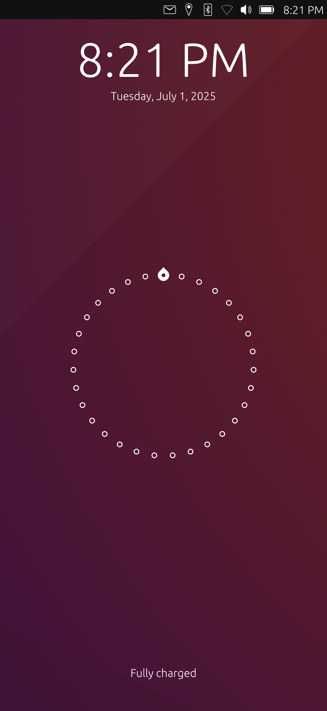
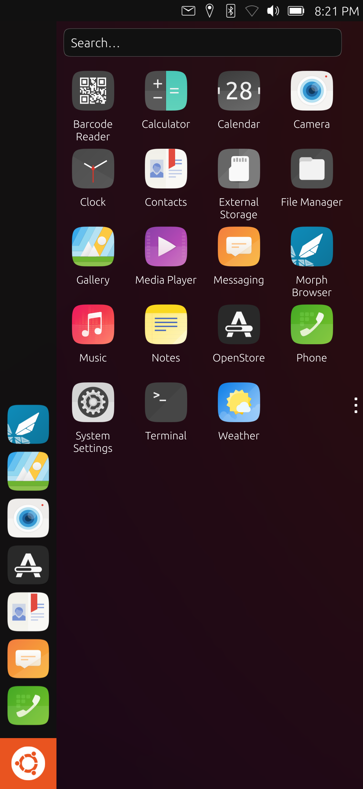
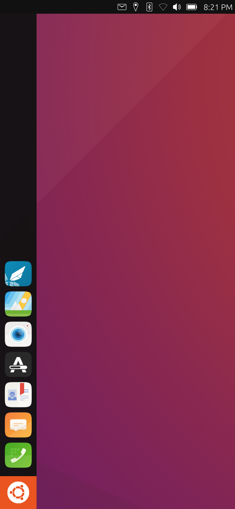
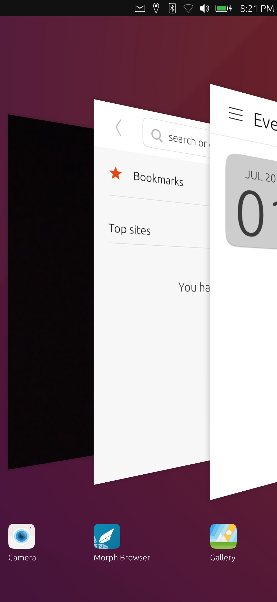

# Ubuntu touch device tree ONLY FOR MIUI 12 (Xioami redmi note 8 2021)

/Xiaomi%20Redmi%20Note%208%20(2021).png?ref_type=heads)

[Device page](https://devices.ubuntu-touch.io/device/biloba/)

## Compile guide

Compilation process requires only docker

```bash
chmod +x build_auto.sh
./build_auto.sh <focal or noble>
```

Images containes in images directory

### Build images from adaptations prebuild (without kernel compileing)

```bash
[ -d build ] || git clone https://gitlab.com/ubports/community-ports/halium-generic-adaptation-build-tools -b main build # Cloning build scripts if don`t exists
GIT_LFS_SKIP_SMUDGE=1 git clone --depth 1 https://codeberg.org/Biloba-UT/prebuilds.git # clone prebuilds repository without flashable images
mv prebuilds/device_adaptations out
rm -rdf prebuilds
source build_functions.sh
choice_deviceinfo <focal or noble>
build_ota_package ota # Fake ota building
build_flashable_images ota images # Convert fake ota to flashable images
```

### Compile output

boot.img - linux + halium initrd

rootfs.img - raw rootfs formated in ext4

system.img - rootfs.img converted to android sparse format

dtbo.img - dtbo prebulit

## Build scripts overview

build_auto.sh - builds adaptations, ota and images for variant passed to first argument

build_ci.sh - builds adapation, ota and images for all avalibale variants

## Port to halium 12 - 13

Xioami don`t publish miui 13 - 14 kernel source for this device

## Flashing

First, you need to download [prebuilds](https://codeberg.org/Biloba-UT/prebuilds) images-0 is 20.04, images_noble is 24.04(testing unstable bad other synonyms here) or [build yourself](#Compile-guide)

After that, you should install the stock firmware version V12.5.9.0.RCUMIXM completely (flash_all).

Then, reboot to fastboot mode (Off device and hold power and vol - buttons) and run this command fastboot reboot fastboot

Finally, run these commands in the terminal window that should be open in the folder where you downloaded the files:

```bash
fastboot flash dtbo dtbo.img
fastboot flash boot boot.img
fastboot flash system system.img
fastboot reboot bootloader
```

Wait fastboot word on display and run fastboot reboot recovery command

After this, the phone will reboot into recovery mode. Then tap on 'Factory reset' -> 'Format data/factory reset' -> 'Format data'. After that, simply reboot the phone.

## Screenshots

   
